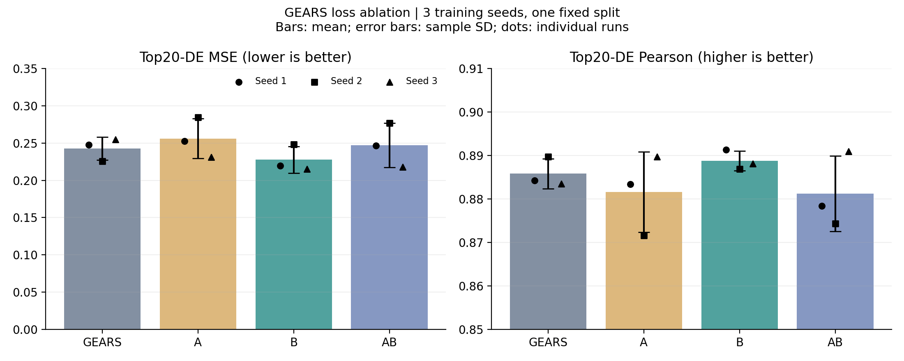
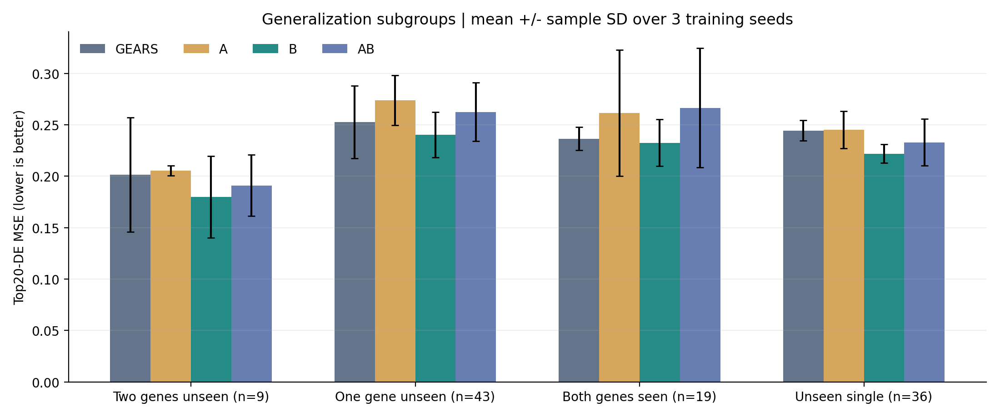

# GEARS 转录响应预测模型复现与损失函数改进

本文面向刚接触深度学习的读者，按数据、网络、训练、修改和实验结论的顺序解释 GEARS。四组、三个训练种子的 GPU 实验均已完成：仅增加可微方向损失 B 时，Top20-DE MSE 平均降低 6.19%；均值监督 A 与 A+B 组合没有取得平均提升。B 的收益存在种子间波动，不能据此声称稳定显著超越 GEARS。

## 一 任务究竟要预测什么

一个细胞里有许多基因，每个基因都有测得的表达量。把同一个细胞的全部表达量按固定基因顺序排列，就得到表达向量。例如只有三个基因时，可以写成 [2.0, 0.5, 1.2]。本次实际数据有 5054 个表达基因，所以一个细胞的标签是长度为 5054 的向量。这些数值属于预处理后的表达数据，不应直接理解成未经处理的原始分子计数。

扰动是人为改变某个基因的活动。例如干预 A，或者同时干预 A 和 B。我们的目标是：给定扰动条件，预测细胞在扰动之后的表达向量。训练时可以看到一部分扰动的真实结果，测试时要求预测未参与训练的扰动。不是把同一扰动的细胞随机拆开，就能检验对新扰动的泛化。

GEARS 的一个重要想法是先预测表达变化，再加到对照细胞的表达上。假设对照表达为 [2, 1, 3]，预测变化为 [0.4, -0.2, 0.1]，最终表达就是 [2.4, 0.8, 3.1]。模型输出的最终表达和表达变化是两个不同概念。源码 forward 最后返回的是最终表达。

## 二 阅读代码前需要理解的概念

### 2.1 参数与训练

网络参数是模型能够学习的数字，包括权重、偏置、嵌入向量。训练的过程是先预测，再用损失函数比较预测与真实标签，通过反向传播计算各个参数应该如何调整，最后由优化器更新参数。

一个 batch 是一次放进模型的一小组细胞，本次通常是 32 个。一个 epoch 是把训练集完整遍历一次。20 个 epoch 表示重复学习训练集 20 次，并不是只有 20 次参数更新。每个 batch 都会进行一次更新，因此一轮可能包含上千次更新。

学习率决定一次更新的步幅。梯度表示参数改变时损失怎样变化。损失是训练过程优化的目标，评估指标则是判断模型效果的尺度，两者不一定相同。本次原始训练 loss 包含四次方误差，而主要测试指标是平方误差，所以不能把训练 loss 的数值直接当作测试 MSE。

### 2.2 张量与形状

张量可以先理解成带形状的数字数组。记 B 为 batch 内细胞数，K 为表达基因数，P 为 GO 图中可扰动基因数，H 为隐藏维度。本次 K=5054、H=64，通常 B=32。P 和 K 不必相等：表达矩阵里的基因集合与知识图中可扰动基因集合服务于不同目的。

一个 batch 的最终预测形状是 [B,K]。每个基因用 H 个数字描述时，隐藏表示形状是 [B,K,H]。源码为了调用某些层，会把它临时展平成 [B*K,H]。reshape 改变数组的组织形状，不是额外学习一个变换；unsqueeze 增添长度为 1 的维度；sum 消去某个维度并求和；cat 将不同表示拼在一起。

### 2.3 常用网络层

Linear(a,b) 将每个长度为 a 的向量变成长度为 b 的向量，计算形式是输入乘权重再加偏置。ReLU 将负数变为零、正数保留，使多层网络具有非线性表达能力。MLP 是多层 Linear 和激活函数的组合。

Embedding(n,H) 可以理解成一张有 n 行、每行 H 个可学习数字的表。输入基因编号，就取出相应行。编号本身不包含基因功能，功能相关的表示来自训练和图信息。不同随机种子的实验会重新初始化这张表。

BatchNorm1d 在训练时利用当前批次的统计量对特征进行规范化，并带有可学习缩放和偏移；在 eval 模式下使用累计统计量。因此训练和验证要正确切换 train()/eval()。本次不使用 dropout，不应把所有随机波动都解释成 dropout 的影响。

## 三 文件之间如何配合

官方模型入口是 upstream/GEARS-master/gears/model.py：MLP 定义通用多层感知机，GEARS_Model.__init__ 构建层，GEARS_Model.forward 定义数据实际经过这些层的顺序。

官方 gears.py 中的 GEARS 类负责把数据、图、网络配置组织起来，model_initialize 构建网络；官方 train 提供原版训练流程。pertdata.py 的 PertData 负责读取数据、组织细胞图、划分数据和生成 dataloader。utils.py 包含原始损失、图构建等工具。inference.py 的 evaluate 和 compute_metrics 负责预测与指标计算。

本次新增的 run_experiment.py 作为实验总入口，调用上述官方模块，统一安排四组方法。没有直接改写官方 model.py 的网络结构，也没有把旧预训练网络当作从头训练的基线。


### 3.1 实验配置记录

| 项目 | 本次设置 |
|---|---|
| 表达数据 | Norman UMI/GO，89357 个细胞、5054 个表达基因 |
| 划分 | simulation，划分种子 1，训练基因比例 0.75 |
| 训练重复 | 训练种子 1、2、3，四组共 12 次 |
| 模型 | 官方 GEARS，隐藏维度 64，结构不变 |
| 优化器 | Adam，学习率 0.001，weight_decay=0.0005 |
| 学习率调度 | 每轮乘 0.5，最多 20 轮，验证最优 checkpoint |
| batch 大小 | 训练 32，验证与测试由本次 dataloader 设置为 32 |
| GPU | NVIDIA GeForce RTX 4070 Ti SUPER，16 GiB 级别 |
| PyTorch | 2.5.1，CUDA 训练与推理 |
| 辅助权重 | A=0.1，B=0.1，实验前固定 |

### 3.2 模型中主要形状的变化

| 阶段 | 形状 | 含义 |
|---|---|---|
| 表达标签 | B×K | B 个细胞、每个 K 个表达基因 |
| 基因基础表示 | B×K×H | 每个表达基因的 H 维隐藏表示 |
| GO 扰动表示 | P×H | 知识图中每个可扰动基因的表示 |
| 融合的扰动表示 | B×H | 每个样本的单基因或组合扰动向量 |
| 第一阶段分数 | B×K×1 | 每个基因的初步扰动分数 |
| 跨基因状态 | B×H | 从全部基因分数提取的细胞整体状态 |
| 拼接后特征 | B×K×65 | H=64 时，单基因分数加 64 维整体状态 |
| 最终表达预测 | B×K | 变化量加输入对照表达后的预测 |

其中 P 是 GO 图的节点数，与表达基因数 K 不相同。表中形状是理解网络的逻辑形状，源码中会多次展平与恢复形状。

## 四 数据怎样进入网络

### 4.1 一条数据中的关键字段

data.x 保存该样本对应的对照表达输入。data.y 是扰动后真实表达标签。data.pert 是可读的扰动条件名称。data.pert_idx 是扰动基因在知识图中的编号，控制条件用特殊值 -1 表示没有扰动。data.de_idx 保存评估时使用的差异表达基因索引。data.batch 标记批处理时每个节点属于哪个细胞。

这里的“图”有两种层次：PyG 的 Data 对象用来组织每个细胞的样本；共表达图与 GO 图则描述基因之间的联系。不要把细胞样本数与知识图节点数混为一谈。

### 4.2 数据划分

prepare_split(split='simulation', seed=1) 按官方方式划分扰动条件，默认训练基因比例为 0.75。具体条件保存在 split.json。同一种扰动条件不能同时属于训练、验证和测试集，脚本中用集合交集断言检查这一点。

训练集用于更新参数，验证集用于选 checkpoint，测试集用于最终报告。当前测试组合包括 combo_seen0、combo_seen1、combo_seen2 和 unseen_single。seen 数字表示两个基因里训练阶段已见过的基因数量，因此 combo_seen0 对应两个均未见，combo_seen2 对应两个均已见，但这个双基因组合本身被留作测试。

三次训练种子 1、2、3 使用同一个数据划分。这可以观察训练随机性，不能代表对三个不同数据划分都成立。最终报告要明确这个限制。

## 五 GEARS 原始网络的构建与前向传播

### 5.1 MLP 辅助类

```python
for s in range(len(sizes) - 1):
    layers = layers + [
        torch.nn.Linear(sizes[s], sizes[s + 1]),
        torch.nn.BatchNorm1d(sizes[s + 1])
        if batch_norm and s < len(sizes) - 1 else None,
        torch.nn.ReLU()
    ]
layers = [l for l in layers if l is not None][:-1]
self.network = torch.nn.Sequential(*layers)
```

sizes=[64,128,64] 表示两次线性变换，先从 64 维变到 128 维，再变回 64 维。循环构建 Linear、BatchNorm、ReLU，过滤掉 None 后通过 [:-1] 删除最后一个 ReLU。Sequential 让各层按顺序执行。

值得注意的是，这份源码虽然接收 last_layer_act 参数并保存到 self.activation，但 forward 只执行 self.network(x)，没有根据这个参数切换最后激活。所以不能仅看到调用时写 last_layer_act='ReLU'，就认定最后一定有 ReLU。讲解代码必须以实际执行路径为准。

### 5.2 基因嵌入分支

```python
self.gene_emb = nn.Embedding(self.num_genes, hidden_size, max_norm=True)
self.emb_pos = nn.Embedding(self.num_genes, hidden_size, max_norm=True)
self.layers_emb_pos.append(SGConv(hidden_size, hidden_size, 1))
```

gene_emb 为表达基因提供基础表示，emb_pos 为图传播提供另一套表示，SGConv 是简化图卷积。最后一个位置参数 1 表示一次传播步数。当前默认只有一层，输入与输出都是 H=64 维，图卷积的重点是融合相邻基因的信息，而不是把基因数从 K 改为 H。

```python
emb = self.gene_emb(gene_ids)
emb = self.bn_emb(emb)
base_emb = self.emb_trans(emb)
pos_emb = self.emb_pos(gene_ids)
pos_emb = layer(pos_emb, self.G_coexpress, self.G_coexpress_weight)
base_emb = base_emb + 0.2 * pos_emb
base_emb = self.emb_trans_v2(base_emb)
```

gene_ids 是按批次重复的基因编号。base_emb 得到基本基因表示，pos_emb 经共表达图传播后以 0.2 的系数加进去，再经 MLP 变换。0.2 是这份实现中的固定系数，不是本次新增的 loss 权重，也不是本次调参得到的结果。

共表达图通过训练数据构建，当前官方实现用训练条件中包含 ctrl 的条件估计相关性，包含对照及相应单基因扰动条件，而不是把所有测试表达也加进去。图的边保存两个基因是否连接，边权保存联系强度。阈值和保留相似基因数量共同限制图的连接。

### 5.3 扰动嵌入分支与 GO 图

```python
self.pert_emb = nn.Embedding(self.num_perts, hidden_size, max_norm=True)
self.sim_layers.append(SGConv(hidden_size, hidden_size, 1))
pert_global_emb = self.pert_emb(perturbation_gene_ids)
pert_global_emb = layer(pert_global_emb, self.G_sim, self.G_sim_weight)
```

pert_emb 为知识图中的基因提供可学习向量。GO 图根据基因功能注释的重合程度连接基因，论文使用 Jaccard 相似度，即注释交集大小除以并集大小。例如两个基因的注释分别为 {a,b} 和 {b,c}，相似度为 1/3。GO 图是外部生物学先验，不能等同于扰动表达标签。

图传播让一个基因能参考功能邻居的表示。因此即便某个基因没有在训练集中被直接扰动，也可能通过知识图得到有用信息。但这不保证每个未见基因都预测准确。

### 5.4 多基因扰动的融合

forward 先把每个样本的 pert_idx 展开为“样本编号、扰动基因编号”对，再把同一样本中所有扰动基因的向量求和，存入 pert_track。双基因 A+B 使用两者向量之和；单基因只使用一个。

```python
pert_track[sample_id] = embedding_A + embedding_B
emb_total = self.pert_fuse(torch.stack(list(pert_track.values())))
base_emb[sample_id] = base_emb[sample_id] + emb_total[index]
```

这里第一行是帮助理解的等价示意，实际代码在循环中逐项累加。求和使 A+B 与 B+A 对扰动集合的表示一致。随后 pert_fuse 的 MLP 提供非线性变换，融合后的样本级向量加到该细胞每个基因的表示上。不能据此简单认定最终预测只是两个单基因预测的相加。

源码中只有一个有效扰动样本时，会把向量临时复制成两份送入 pert_fuse，以绕过训练时 BatchNorm 不能使用单样本统计的问题。这是实现细节，不表示数据集新增了两个不同的生物学样本。

### 5.5 第一阶段的基因专属解码器

```python
self.recovery_w = MLP([hidden_size, hidden_size*2, hidden_size])
self.indv_w1 = nn.Parameter(torch.rand(self.num_genes, hidden_size, 1))
self.indv_b1 = nn.Parameter(torch.rand(self.num_genes, 1))
```

先用共享 MLP 把每个基因的 H 维表示继续变换。indv_w1 和 indv_b1 是每个基因专属的权重与偏置，nn.Parameter 表示它们会进入优化器并参与训练。Xavier 初始化用于给参数设置合适的起始尺度。

```python
out = self.recovery_w(base_emb)
out = out.reshape(B, K, H)
out = out.unsqueeze(-1) * self.indv_w1
w = torch.sum(out, axis=2)
out = w + self.indv_b1
```

reshape 得到 [B,K,H]，unsqueeze 后为 [B,K,H,1]，与 [K,H,1] 的权重按广播规则相乘。沿 H 维求和并加偏置，得到 [B,K,1]，即每个细胞、每个基因的一个初步分数。广播是让较小的数组按规则适配形状，不是人为新增参数。

### 5.6 跨基因状态与最终解码

```python
self.cross_gene_state = MLP([self.num_genes, hidden_size, hidden_size])
self.indv_w2 = nn.Parameter(torch.rand(1, self.num_genes, hidden_size+1))
self.indv_b2 = nn.Parameter(torch.rand(1, self.num_genes))
```

cross_gene_state 读入一个细胞全部 K 个初步分数，输出 H 维的细胞整体状态。其作用是让最终预测参考跨基因的信息。

```python
cross_gene_embed = self.cross_gene_state(out.reshape(B,K,-1).squeeze(2))
cross_gene_embed = cross_gene_embed.repeat(1,K).reshape(B,K,H)
cross_gene_out = torch.cat([out,cross_gene_embed],2)
cross_gene_out = cross_gene_out * self.indv_w2
out = torch.sum(cross_gene_out,axis=2) + self.indv_b2
```

每个基因获得同一个细胞整体状态，与自己的初步分数拼接，组成 H+1=65 维向量。第二组基因专属权重把 65 维压成 1 个数，结果是 [B,K] 的预测变化。

```python
out = out.reshape(B*K,-1) + x.reshape(-1,1)
out = torch.split(torch.flatten(out), K)
return torch.stack(out)
```

把预测变化加到输入对照表达 x 上，分回每个细胞，最后输出 [B,K]。注意：在这份 forward 中，表达 x 在最后相加；前面的隐藏表示主要由基因编号、图和扰动条件建立。不能把它讲成“先用编码器逐层编码 x 的表达值”，因为实际代码不是这样执行的。

### 5.7 没有在本实验启用的部分

uncertainty=True 时有额外分支预测不确定性。本次默认 False，四组都没有用这个分支。no_perturb=True 会直接返回输入表达，作为不施加扰动变化的路径，本次也未启用。部分成员如 pert_w 在 __init__ 中被定义，但在当前正常 forward 路径没有被调用；不能仅凭定义就给它安排一个不存在的作用。

## 六 原始损失与训练流程

### 6.1 原始损失实际上包含四次方误差

utils.py 的 loss_fct 设置 gamma=2，计算 (pred-y)**(2+gamma)，所以误差是四次方。某个基因误差从 1 增到 2，四次方项从 1 增到 16。它会更强调大误差，但也可能更受极端值或细胞噪声影响。

函数按 batch 中扰动条件分别计算，再对条件平均。非对照条件会用 dict_filter 去除对应条件的全零基因。这与主评估时只看 Top20 DE 基因不是同一件事。所有训练步骤都只对训练条件调用损失。

原始方向项比较 sign(y-ctrl) 与 sign(pred-ctrl)。sign 将正数变为 1、负数变为 -1、零变为 0。但 PyTorch 的 sign 对输入的梯度几乎处处为零，因此这个方向项虽然进入 loss 数值，在普通反向传播中不能像平滑损失一样提供有效的方向修正梯度。这是新增 B 的代码层动机，并非声称原模型整体无法学习变化方向。

### 6.2 一次训练更新

```python
model.train()
batch = batch.to('cuda')
opt.zero_grad()
pred = model(batch)
loss = loss_fct(pred,batch.y,batch.pert,...)
loss.backward()
torch.nn.utils.clip_grad_value_(model.parameters(),1.0)
opt.step()
```

train 打开训练模式，to 将数据放到 GPU；zero_grad 清除上一次梯度；model(batch) 调用 forward；loss.backward 沿计算过程反向求梯度；梯度裁剪把各梯度分量限制在指定范围，降低异常更新风险；step 才真正更新参数。单独运行 backward 不会自动完成参数更新。

本次沿用 Adam、学习率 0.001、weight_decay=0.0005，以及每轮把学习率乘 0.5 的 StepLR。后期学习率会很小，这是当前官方训练设置的延续，没有把调度策略改动混进 A/B 消融里。

验证时使用 eval 和 no_grad，不进行反向传播。每轮验证后，如果 mse_de 比历史最好值更低，就保存 best.pt。因此“第 20 轮结束”与“采用第 20 轮权重”不是一回事。

## 七 本次到底在哪里修改

### 7.1 修改边界

网络结构保持为官方 GEARS_Model。新增内容位于 run_experiment.py 的 auxiliary 函数和训练循环调用处。除损失外，脚本增加了实验分组、固定种子、检查集合无交叉、保存 checkpoint、GPU 计时和结果输出。这些实验管理代码不应被描述成一个新的神经网络模块。

本次没有添加蒸馏教师、预训练编码器或新的网络包，也没有将 A、B 说成从网络中删掉的物理 block。消融的实际含义是分别启用或关闭两个辅助损失，每组重新训练。

### 7.2 辅助目标从哪里来

```python
means = {p: torch.tensor(np.asarray(X[obs==p].mean(0)).ravel(),
                         dtype=torch.float32,device='cuda')
         for p in d.set2conditions['train']}
target = torch.stack([means[p] for p in perts])
```

先对每个训练扰动条件的全部细胞求平均表达，再按当前 batch 的扰动条件逐个取出，堆成 [B,K] 的 target。该目标只来自训练标签，没有读取验证或测试扰动的均值。使用同一个训练扰动的多个训练细胞求均值属于训练统计，不是独立的新数据集。

### 7.3 A 的每行代码

```python
if use_a:
    extra = extra + 0.1 * F.mse_loss(pred, target)
```

F.mse_loss 默认把所有元素的平方误差取平均，0.1 是事先固定的辅助权重。原始单细胞监督还在，只是额外鼓励预测靠近该扰动的平均结果。

假设同一个扰动的两个训练细胞某基因表达分别为 0 和 4，均值是 2。只盯着每个细胞的观测值，会同时受到这两个极端目标影响；A 提供了一个稳定的中心目标。但如果细胞确实有多个重要亚群，均值也可能掩盖异质性，因此 A 不一定总有效。

### 7.4 B 的每行代码

```python
delta = target - ctrl
weight = delta.abs() / (delta.abs().mean(dim=1,keepdim=True) + 1e-6)
extra = extra + 0.1 * (
    weight * F.softplus(-delta.sign() * (pred-ctrl))
).mean()
```

delta 是训练扰动均值相对于对照均值的变化。abs 取变化幅度。mean(dim=1,keepdim=True) 对每个样本的基因维度求平均，并保留 [B,1] 形状以便广播。加 1e-6 避免分母为零。变化较大的基因权重较高，变化几乎为零的基因权重低。

softplus(t)=log(1+exp(t))，是平滑可微的函数。真实变化为正时，delta.sign()=1；预测变化为负，括号内负号使输入 softplus 的数变大，惩罚也较大。梯度会推动预测向上。真实变化为负时则相反。

这里仍然有 sign，但它作用在不需要学习的训练目标 delta 上，预测 pred 没有经过 sign，所以梯度可以传回网络。这与原始 sign(pred-ctrl) 的关键区别就在于 sign 作用的位置。

B 不是只要方向正确损失就严格归零，也不能独自决定合理幅度，因此保留原版误差项来约束数值大小。新增 loss 已单独检查：目标相等时 A 为零；B 对正负两种错误方向都给出纠正方向的梯度。

### 7.5 总损失与四组消融

```python
loss = loss_fct(...)
if a or b:
    loss = loss + auxiliary(pred,batch.pert,means,ctrl,a,b)
```

| 组别 | 原始 GEARS loss | A 均值监督 | B 可微方向监督 |
|---|---|---|---|
| GEARS | 使用 | 不使用 | 不使用 |
| A | 使用 | 使用 | 不使用 |
| B | 使用 | 不使用 | 使用 |
| AB | 使用 | 使用 | 使用 |

每组从头训练，统一模型结构、数据划分、训练轮数和优化器。比较 AB 与 A，观察在 A 基础上增加 B 的作用；比较 AB 与 B，观察 A 的作用；比较 AB 与 GEARS，观察合起来的效果。必须允许 A、B 有相互影响，不能直接把两个单独提升百分比相加。

## 八 怎样理解最终指标

官方 compute_metrics 先在同一扰动条件内对全部细胞的预测和标签分别求均值，再计算该条件的误差与相关系数，最后对条件取平均。这是按扰动条件的宏平均，不是把每个细胞的误差全部混在一起求平均。

mse_de 只在该条件的 Top20 差异表达基因上计算 MSE，越低越好；mse 使用全部表达基因。pearson_de 和 pearson 衡量向量变化趋势的一致性，通常越高越好，但表达值的相关性不能代替对照差值相关性，也不能证明预测幅度完全准确。

Top20 DE 是官方评估所需的标签定义。测试集的 DE 排名仅用于评估，不拿来选择训练基因权重。本次 B 的权重来自训练均值变化，不是测试 DE 排名。

某方案的改善百分比=(GEARS 的 mse_de - 该方案的 mse_de)/GEARS 的 mse_de×100%。本次 B 为改善 6.19%，AB 为退步 1.89%。若结果为负，就是退步。三个种子报告均值和标准差，同时检查双基因不同泛化难度子组。只在单个种子上有很小优势，不能夸大成稳定提升。

## 九 怎样测量时间与显存

GPU 操作通常异步执行，Python 发出运算命令后不一定等待 GPU 做完。因此计时前后调用 torch.cuda.synchronize，确保统计的是实际完成运算的时间。训练时间累计每个训练 epoch，不含数据准备、验证和 checkpoint 写盘；验证单独记录。

推理先预热，再对同一完整测试集计时，包含批次搬到 GPU 和结果回到 CPU 的开销。另用 CUDA Event 测量同一个固定 batch 重复 30 次的平均 GPU forward 延迟，单位毫秒。这两种口径不同，报告不能混用。

训练与推理分别调用 reset_peak_memory_stats 并读取 max_memory_allocated，换算为 GiB。该数值表示 PyTorch 已分配显存的峰值。nvidia-smi 显示的是更广的设备或进程占用，因此两者有差异并不代表统计错误。

本次为节省准备时间，将共表达相关矩阵的同一计算公式移到 GPU，并先用小矩阵与官方 NumPy 公式核对。四组使用同一预处理和同一张图。该准备加速不作为 A/B 模型效果提升的证据，也不混入训练加速比例。


### 9.1 为什么整卡占用比张量显存峰值更高

max_memory_allocated 统计当前 Python 进程中由 PyTorch 分配器追踪的张量显存历史峰值，包括存活的参数、梯度、优化器状态、激活、输入等。memory_reserved 则是分配器持有的显存池总量，其中已包含 allocated，不能把两者直接相加。

nvidia-smi 的整卡占用还可能包括 PyTorch 已释放张量但暂留的空闲缓存、CUDA 上下文、加载的内核或运行库的额外分配，以及 Windows 桌面、浏览器和其他程序。库的临时工作区若通过 PyTorch 分配器申请就可能已计入，若直接申请则可能没有，因此不能把所有库开销一律视为额外显存。

本次记录的训练张量峰值约 0.855 GiB，而训练中整卡曾观察到约 3 GiB，两者口径不同。没有同步记录 reserved 与逐进程完整占用，不能精确拆分差额，更不能用某一时刻整卡占用减去历史张量峰值，声称得到 CUDA 上下文大小。

## 十 完整实验结果与讨论

### 结果结论

12 次实验均已完成：GEARS、A、B、AB 四组，每组训练种子 1、2、3，每次 20 轮。每次都有完整训练历史、验证最优权重、最终测试指标和子组结果。测试集为相同的 28754 个细胞。最终图片与结论文件已生成。

最有希望的方案是仅增加 B 的 GEARS。其 Top20-DE MSE 平均降低 6.19%，DE Pearson 从 0.88584 升到 0.88876。A 单独使用退步 5.59%，AB 退步 1.89%。因此不能说“原先设计的 A+B 成功提升”，本次消融支持保留 B、舍弃当前配置的 A，作为下一轮独立验证候选。

### 总体指标与消融

A 是训练扰动均值的辅助 MSE，B 是用训练均值变化赋权的可微方向损失。这里的“删掉 A/B”是每组重新训练时关闭相应 loss，并非把训练好的网络临时拆掉。

| 方法 | Top20-DE MSE 均值 ± 标准差 | 相对 GEARS 误差降低 | Top20-DE Pearson 均值 ± 标准差 |
|---|---|---|---|
| GEARS | 0.24273 ± 0.01528 | +0.00% | 0.88584 ± 0.00343 |
| A | 0.25628 ± 0.02685 | -5.59% | 0.88159 ± 0.00925 |
| B | 0.22771 ± 0.01775 | +6.19% | 0.88876 ± 0.00228 |
| AB | 0.24730 ± 0.02971 | -1.89% | 0.88121 ± 0.00867 |

正百分比表示改善，负百分比表示退步。百分比按两组均值之比计算，并非各随机种子百分比的平均。标准差使用三个训练种子的样本标准差，不是置信区间。



AB 的平均 DE MSE 比 B 高约 8.61%，在 B 上增加 A 反而削弱了效果；在 A 上增加 B 则把平均误差降低约 3.50%，但仍未超过原版。说明两个想法不是简单相加就更好，当前 A 对 B 也没有正向互补。

补充全基因 MSE：GEARS 为 0.009798，B 为 0.009522，降低约 2.82%；A 与 AB 分别为 0.010181、0.010096，均退步。因此 B 的平均改善不只出现在 DE 子集，但幅度在 DE 基因上更明显。

### 随机种子的稳定性

| 种子 | GEARS DE MSE | A | B | AB | B 相对 GEARS 误差降低 |
|---|---|---|---|---|---|
| 1 | 0.24755 | 0.25280 | 0.21963 | 0.24690 | +11.28% |
| 2 | 0.22562 | 0.28471 | 0.24806 | 0.27721 | -9.95% |
| 3 | 0.25501 | 0.23135 | 0.21543 | 0.21780 | +15.52% |

B 在种子 1、3 上分别改善约 11.28%、15.52%，在种子 2 上退步约 9.95%。AB 在种子 2 上退步约 22.86%，波动更明显。B 的 DE MSE 标准差也没有低于基线，因此不能宣称它在该主指标上更稳定。

仅有三个训练种子，且固定了同一数据划分，不足以建立跨划分的稳定显著优势。本报告不把均值降低直接写成统计显著提升。四种方案虽然在实验前固定，但现在依据测试表现选出 B，仍属于探索性模型选择；若要形成更强的泛化结论，需要在未用于选方案的划分或数据集上复核。

### 不同泛化难度的表现

| 测试子组 | GEARS | A | B | AB | B 的误差降低 |
|---|---|---|---|---|---|
| Two genes unseen (n=9) | 0.20138 | 0.20534 | 0.17969 | 0.19109 | +10.77% |
| One gene unseen (n=43) | 0.25268 | 0.27389 | 0.24042 | 0.26260 | +4.85% |
| Both genes seen (n=19) | 0.23647 | 0.26158 | 0.23252 | 0.26639 | +1.67% |
| Unseen single (n=36) | 0.24447 | 0.24520 | 0.22199 | 0.23301 | +9.20% |

表中为各子组跨种子的平均 DE MSE。combo_seen0 表示两个基因都未见；combo_seen1 表示其中一个未见；combo_seen2 表示两个单基因都已见，但这个组合本身在测试集。数字 n 是扰动条件数，不是细胞数。



B 在四个子组的平均误差都较低，最明显的是两个基因均未见与未见单基因，说明平均收益并非仅来自最容易的双已见组合。不过均未见组合只有 9 个，且基线种子间波动较大，需要谨慎解读。

各子组原始表达变化幅度和标签分布不同，不能通过“某组 MSE 更低”直接认定它更容易。例如均未见组的 MSE 较低，并不意味着模型在这一类泛化更强；其 DE Pearson 平均只有约 0.73，明显低于其他组，体现了指标观察角度不同。

### 训练 推理与显存

| 方法 | 训练分钟 | 整测试集推理秒 | 固定 batch 前向毫秒 | 训练峰值 GiB | 推理峰值 GiB |
|---|---|---|---|---|---|
| GEARS | 34.80 | 13.76 | 12.33 | 0.8551 | 0.3782 |
| A | 34.98 | 13.57 | 10.94 | 0.8549 | 0.3785 |
| B | 35.21 | 13.17 | 12.09 | 0.8553 | 0.3785 |
| AB | 35.12 | 13.49 | 11.03 | 0.8548 | 0.3785 |

训练时间是每次 20 轮的纯训练总时长，表中为三次均值，不含验证、数据准备和保存文件。完整测试集推理包含数据搬运及结果回 CPU；固定 batch 前向耗时使用 CUDA Event 测量，batch 大小为 32。两种耗时不可直接相除来推算纯算子速度。

B 的平均训练时间比 GEARS 多约 24.68 秒，即 1.18%；整测试集推理表面上少约 0.59 秒，即 4.29%。但网络结构没有改变，新增 loss 在推理时不执行，固定 batch 延迟也有明显的时间顺序波动。因此结论应是“训练开销基本不变，推理计算结构相同”，不能宣称 B 实现了确定的推理加速。实验按固定方法顺序执行，也没有交错重复多轮测速，频率、后台任务等会影响测速。

四组训练峰值都约 0.855 GiB，推理约 0.378 GiB，差异很小。这里是 torch.cuda.max_memory_allocated 的 PyTorch 已分配显存峰值，包含测量时存活的对象，并非仅网络参数占用，也不等于 nvidia-smi 观测的约 3 GiB 整卡占用。

全部 12 次纯训练累计约 7.01 小时，验证累计约 22.47 分钟，另有数据准备、评估与文件读写时间。

### 为什么 B 可能更好

原始方向项把预测变化也放入 sign，而 sign 对预测的梯度几乎处处为零。B 保留固定训练目标变化的 sign，让预测变化进入平滑 softplus，因此方向错误时可以直接提供梯度。再用训练扰动均值变化幅度赋权，使较大变化比接近零的变化获得更高关注。

这与 B 平均 DE MSE 和 DE Pearson 改善的结果一致，是合理的机制解释。但 B 同时改变了损失的可微性、目标的均值化以及基因权重，本次没有进一步拆分这三个因素，不能独断地把全部 6.19% 都归功于其中一个。当前保存结果也没有直接统计方向正确率，因此不能将机制推测写成“实测方向正确率提高”。

### 为什么 A 与 AB 没有更好

A 原本希望用扰动均值减少单细胞噪声，但与原版四次方误差相比，均值 MSE 的梯度尺度不同，也可能把具有细胞异质性的目标向中心收缩。加上固定 0.1 权重，未必与原目标相容。A 单独和加入 B 后都未提高总体平均主指标，说明当前设置没有获得预期收益。

以上是候选解释，不是本次实验已证明的因果机制。还不能说所有均值监督都无效；只能说本次这种写法、权重和训练设置没有表现出优势。若继续研究，应先在验证集上选择权重或晚期启用策略，再用新测试划分评估。

### 训练曲线与实验局限

12 组的验证最优轮次全部在第 1 至第 5 轮。脚本已经采用验证最佳 checkpoint，因此后续轮次的较差权重没有替换它。这个现象说明继续训练到 20 轮没有改善验证最优成绩，也提示学习率调度与模型选择值得进一步研究；仅凭它还不能直接证明所有组都严重过拟合。

若今后用 early stopping 节省时间，必须在所有方法上统一规则并重新测量，不能把本次 20 轮成绩与推算出来的早停时间拼在一起，冒充实测加速。

本次为本地 Norman UMI/GO 数据、一个 simulation 划分与三个训练种子的受控对比。它不等同于论文全部数据集或论文表格的严格版本复现，不能声称在所有场景超越 GEARS。GO 图使用已有外部知识拓扑，网络从头初始化；测试 DE 排名只用于评估，辅助标签来自训练扰动均值。

### 可用于作业的结论表述

本实验在相同数据划分与训练配置下，对 GEARS 增加训练扰动均值监督 A 和可微方向监督 B，并开展四组、三个训练种子的消融实验。仅增加 B 时，Top20 差异表达基因的 MSE 从 0.24273 降至 0.22771，平均降低 6.19%，且训练耗时和显存基本不变。A 单独使用及 A+B 组合未带来平均提升。B 在三个种子中的两次改善、一次退步，说明结果仍受训练随机性影响，尚需在更多独立划分上验证。

数据依据：results/summary.csv、12 组 metrics.json、subgroups.json、history.csv。图表根据已保存的实测值生成，没有重新训练或挑选表现最好的单次测试作为总结果。

## 十一 复现与阅读建议

实际运行目录为 C:/Users/Yeliang/Documents/d2l learning pytorch/reproduction/experiment。用 F:/anaconda/envs/gears/python.exe 执行 run_experiment.py，参数为 --epochs 20 --seeds 1 2 3。本次 12 次实验已完成。运行相同配置时，脚本会跳过已有 metrics.json 的完整组；它不支持从未完成 epoch 恢复优化器状态。若要进行新的实验，应建立独立目录，不能混用旧结果。

建议先理解“输入与标签是什么”，再看 forward 中最终加上 x 的位置，然后按本文顺序读两条嵌入分支、扰动融合、两级解码器。最后读 auxiliary 和训练循环。先记录每一步形状，再理解公式，通常比从第一行机械阅读整个仓库更容易。

## 十二 材料来源

用户提供的 Roohani 等 GEARS 论文 PDF 与 GEARS.pptx。论文官方全文：https://pmc.ncbi.nlm.nih.gov/articles/PMC11180609/ 。官方实现：https://github.com/snap-stanford/GEARS 。论文实验代码：https://github.com/yhr91/GEARS_misc 。

本次主实现使用本机已有 GEARS-master.zip 解压副本，历史 commit 未知，已保存压缩包 SHA256。部分外部 GO 拓扑来自本机已有论文实验配置，只复用拓扑，不加载预训练网络权重或旧共表达图。最终报告需保留这些版本与来源说明。


## 十三 修改位置与代码阅读索引

下表行号对应本次实际执行的 run_experiment.py 原文件。逐句中文注释副本保留相同代码逻辑，但由于添加注释，其显示行号会不同；副本内注明了原行号。

| 文件与位置 | 功能 | 本次处理 |
|---|---|---|
| model.py 中 GEARS_Model.__init__ | 创建嵌入、GNN、MLP、解码参数 | 沿用原版 |
| model.py 中 GEARS_Model.forward | 完整预测路径 | 沿用原版 |
| utils.py 中 loss_fct | 原始四次方误差与方向项 | 原函数保留并调用 |
| run_experiment.py 第 19 至 26 行 | GPU 计算相关矩阵 | 同公式预处理加速，所有组共用 |
| 第 36 至 53 行 | 数据复制、划分、加载器 | 新增受控实验准备 |
| 第 55 至 66 行 | auxiliary 函数 | A/B 核心修改 |
| 第 79 至 85 行 | 训练扰动均值标签 | 仅从训练条件计算 |
| 第 93 至 98 行 | 种子与消融循环 | 三种子、四组独立训练 |
| 第 110 至 114 行 | 前向、损失、反传、更新 | 第 113 行将辅助 loss 加到原 loss |
| 第 120 至 127 行 | 验证与 checkpoint | 验证 DE MSE 最优选择 |
| 第 129 至 153 行 | 测试、分组、GPU 测速 | 新增测量记录 |
| 第 159 至 178 行 | 汇总、绘图、结论 | 新增输出逻辑 |

## 十四 文件与复现核对清单

最终实验数据以 results/summary.csv 和各组 metrics.json 为准；history.csv 是每轮训练损失及验证指标；per_condition.csv 与 subgroups.json 用于核查不同扰动的结果；best.pt 是验证最优权重。mean.csv 与 std.csv 是三个种子的均值和样本标准差。分析配图中的误差棒也是标准差，不是置信区间。

run_v3.log 是实际完整运行日志。Timeout 每 180 秒出现一次是 faulthandler 的定时堆栈诊断，不是超时终止。__pycache__ 是 Python 导入模块后自动产生的字节码缓存，cache 是 Numba 编译缓存，二者都不是模型训练权重。

源码压缩包 SHA256 与实际导入路径分别记录在 source_hash.json、environment.json；扰动划分记录在 split.json。官方 zip 历史 commit 未知、数据版本与论文默认数据未严格统一等限制，必须在作业中保留，不能把本次受控对比写成完整论文复现证明。

原文件的逐句中文注释副本位于 C:/Users/Yeliang/Downloads/科训/run_experiment_逐句中文注释版.py。副本因存放位置不同，ROOT 会改变，所以用于阅读，不要直接在那里启动训练。
